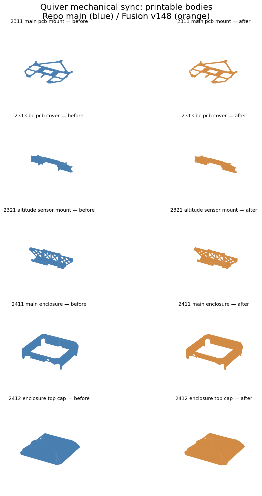

# Fusion v148 mechanical sync — draft review

Source: `Quiver_PT3_Drone_Assembly` v148, saved July 30, 2026 at 17:55:10 UTC.
Compared with repository main `ef316bc9f4e9e001dd5421f8070e54f3180f1600`.
The read-only export was taken September 18, 2026; the Fusion design was not saved
or modified. This is a review snapshot, **not a manufacturing release**.

## Scope

| Part | Change from repository STEP | Fusion reference |
| --- | --- | --- |
| 2311 main PCB adapter | Threaded inserts and screws replace snap-in pins; updated rubber spacers | `New_Main_PCB_Adapter_0226_2`, v4 |
| 2313 battery-PCB cover | Envelope depth 44.09 → 27.35 mm; solid volume −10.94% | `UPDATED_2313 - BCPCBCover.f3d`, v1 |
| 2321 sensor mount | Same envelope; detail geometry changes, volume +0.79% | In-document component |
| 2411 enclosure | Envelope 330.19 × 347.39 × 93.00 → 330.19 × 319.25 × 91.00 mm | `UPDATED_2411-MainEnclosure`, v3 |
| 2412 top cap | Envelope 306.60 × 306.66 × 50.31 → 319.20 × 309.16 × 54.85 mm | `UPDATED_2412-TopCap.f3d`, v1 |
| 2341 PPP/beacon mount | Old bracket replaced by the 79.19 × 79.19 × 8.00 mm mounting board | `2340-PPP, Beacon_mounting_board_v3`, v12 |
| 3200 peripherals, 3310 main PCB | Eight parts moved to their Fusion occurrence placement (see below) | `3000-Equipment` occurrences |



Dimensions are axis-aligned CAD envelopes, not manufacturing tolerances. Volume
changes are geometric measurements, not weight estimates. Plates, compared cockpit
beams, battery slider, and attachment spacers match the existing STEP geometry and
are intentionally unchanged. GPS changes are separate.

## PPP/beacon mount: replacement, not an addition

The first draft of this PR added the mounting board as a new part (2342) next to
the old 2341 bracket, because both are visible in the Fusion master. That was
wrong. As placed in v148 the two parts overlap by about 990 mm³, and the
relocated PPP adapter overlaps the old bracket, so they cannot both be built.
The published `2341.stl` and Step 22 of the Manufacturing Guide already show the
board as part 2341 (the STL matches the board within 0.008% volume); only the
2341 STEP source was stale. The board STEP now replaces it, and the 2342 part,
BOM line, and duplicate STL are gone. The old bracket in the Fusion master
looks like a leftover that should be hidden or deleted there.

## Equipment placement (review follow-up, October 2026)

Erick's review flagged three peripherals. A check of every 3200 part against the
v148 occurrences found four more, mostly side effects of the parts this PR
updates, and the main PCB floated above the new adapter. Each correction
reproduces the Fusion occurrence transform; after the move, repository and
Fusion geometry agree to within 0.06 mm.

| BOM (Fusion) | Part | Was | Now |
| --- | --- | --- | --- |
| 3260 (3231) | Push button | Right (+X) side, 2 mm high, inside the new 2411 wall | Left (−X) side of the front face, clear of the enclosure |
| 3280 (3223) | SIYI HM30 air unit | Component frame, not rotated | Rotated 180° about Z |
| 3290 (3212) | Nanoradar MR82 | Component frame: upside down, tilted 5°, into the 2321 mount | Rotated 180°, tilt removed, clear of the mount |
| 3210 (3211) | RPLidar S2L | 4 mm low, inside the new 2412 top cap | Seated in the top-cap slot |
| 3201 (3271) | PPP adapter | Old bracket position | On the 2341 board (37 mm move) |
| 3202 (3261) | Remote ID beacon | Old bracket position | On the 2341 board (17 mm move) |
| 3220 (3213) | NRA15 radar altimeter | 5 mm off in X | Fusion position |
| 3310 (3310) | Main PCB | 7.4 mm above the adapter | Resting on the adapter, where its screws reach |

The repository BOM numbers differ from the Fusion component numbers in this
subassembly; the first column lists both. Antennas and camera already matched.
A regression test now checks the world bounds and center of mass of all ten
peripherals and the main PCB board against the recorded Fusion placements.

## Placement and hardware

The adapter's native export requires a **−7.85 mm Z translation**, measured from
the Fusion occurrence, replacing the old +13.15 mm correction. The other five
updated bodies already contain their world placement. Independent source bounds,
occurrences, linked versions, and file hashes are recorded in
[the provenance manifest](../src/quiver/fusion-mechanical-provenance.json).
Regression tests compare printable-body world bounds with those measurements.

The adapter STEP contains 34 solids, including 12 screws, 16 inserts, and five
rubber spacers. Only its largest solid is the printable adapter. The existing BOM
and Step 6 already describe 16 short inserts (FAST-024) and five rubber spacers
(FAST-033); the 12 modeled screws are part of the existing FAST-014 allocation,
not 12 additional purchases. Hardware names in the source model disagree on
insert length; they are not procurement authority. The BOM specifications remain
unchanged pending physical confirmation.

## Print files and review gates

The repository is a mixed snapshot: several existing, watertight manufacturing
STLs already have the revised envelopes even though their STEP sources were old.
The existing 2311, 2313, 2321, 2341, 2411, and 2412 STLs are therefore **not overwritten**.
All six meshes pass closed-surface and consistent-winding checks.
Against the source Fusion body measurements, their volume differences are below
0.08% and their maximum bound differences are below 0.014 mm. Recorded results
and file hashes are in [print mesh checks](print-mesh-checks.json). These checks
support retaining the existing files; they do not prove exact surface equivalence
or physical fit.

- **Correction: the existing 2321 STL is not established to be stale.** Its volume
  is approximately 63,337 mm³; Fusion records 63,327 mm³ and the valid imported
  STEP solid measures 63,332 mm³. The earlier 62,450 mm³ figure came from the
  defective generated mesh, not the STEP solid. The STEP-to-STL exporter skipped
  geometry; that trial was discarded. Keep the existing watertight STL. A direct
  Fusion export remains the preferred way to establish exact revision provenance,
  but these measurements are not evidence that the existing print file is wrong.
- Confirm revision provenance for retained meshes with the revised sources before a new
  print release. They remain the existing manufacturing files, not newly validated
  exports from this PR.
- Confirm adapter insert lengths and physical stack-up against the current build.
- Review enclosure/hinge/latch fit and sensor clearance; the automated tests check
  source placement and assembly integrity, not every physical interface.

## Final sync: handed parts, full poses, Fusion retired (October 16, 2026)

Decisions after the full build123d review: the mirrored parts are real, the
BOM/CAD numbering stays, the Fusion master is retired, and placement switches to
full poses. The build123d model is now the master.

Earlier the same day: the propellers were regrouped into diagonal CW/CCW pairs
(Quad X; the repository had same-side pairs), the carbon tube walls went from 2 mm
to 1 mm (30x28 tube, as in the BOM and Fusion), and the right 2111 spacer was
turned about Y, as Fusion places it.

**Handed parts.** Parts the repository modeled as one STEP used twice are mirror
images in Fusion. Each hand now has its own BOM number and STEP file:

| BOM | Part | Hands | Source |
| --- | --- | --- | --- |
| 1212 / 1213 | Cockpit support beam, CCW back / front | 1213 mirrors 1212 | Fusion components 1212-CCW_Back, 1213-CCW_Front |
| 1221 / 1222 | Battery wall, left / right | 1221 mirrors 1222 | Fusion 1221-LeftWall, 1222-RightWall (the old 1221 STEP is the right wall) |
| 1331 / 1332 | Landing gear main adapter | FR, BL / FL, BR | 1332 is 1331 mirrored about its own YZ plane; matches Fusion 1332-FL and 1333-BR within 3e-5 mm |
| 1341 / 1342 | Landing gear tube joint | FR, BL / FL, BR | Same, within 2e-5 mm. Fusion models the joint this way; still to be confirmed |

**Full poses.** Every part is placed with `place(part, pos, rot)`, a full rigid
transform equal to its Fusion v148 occurrence transform. The pose of each of the
82 part instances was solved from the Fusion geometry (B-rep vertex or per-solid
fits); after rounding, nearly every part lands within 1e-4 mm of Fusion.
`place_at()`, which matched only the center of mass, is gone. The new
`tests/test_placement.py` checks bounds, centroid and 16 reference vertices of
every instance against `src/quiver/part-poses.json`. Errors this exposed, now fixed:

| Part | Was | Now |
| --- | --- | --- |
| Landing gear adapters, tubes, joints | 21.18° tilt, derived from two rounded distances | Fusion's 21.000° |
| 3112 BL propeller | Turned 180° about its shaft (7.8 mm vertex error; same center and bounds) | Fusion pose |
| 3320 BC PCB | 19.2 mm above the 2312 mount | Seated in the mount |
| 1212 CCW back beam | 0.024 mm off | Fusion pose |
| 2112 bottom interface | 0.09 mm and 0.02° off | Fitted to Fusion's pins and springs, kept square |

**BC PCB and busbars.** The 3320 STEP was already V1.3: it is identical to Fusion's
`Front_PCB_V1.3` (229 solids, fit within 1e-12 mm), including the heatsink and
connector bodies that the KiCad V1.3 export from #271 lacks. The 3310 and 3320
board bodies match the KiCad sources (Dev-Kit V1.2 main board, V1.3 battery board)
exactly. The 4010 busbars now use Fusion's 40.3 mm 3322/3323 design (the old ones
were 29 mm tall).

Kept on the repository pose instead of Fusion's: the foam sleeves (Fusion draws
them 2 mm above the tube axis), and the GNSS mount and Wren Mini, which are not in v148.

**BOM and guide.** BOM: the handed items above, cockpit beams 40x40x1 mm, lower
plate 4 mm sheet. The Manufacturing Guide now uses BOM/CAD numbers throughout; it
used Fusion instance numbers, which differ from the BOM in 3200 and 3300.

Open items:

- 1332 and 1342 are confirmed handed (Thomas, October 16). The BOM carries both
  hands as separate lines; the remaining note is procurement only — confirm the RJX
  adapter and INNLOI joint can be sourced or customized in both hands.
- The 2420 hinge is a symmetric COTS part (JW Winco GN 237). The mirrored CAD
  instance is the same hinge flipped for the far side, not a different part, so one
  part number bought twice is correct; GN 237 has no handed variant. (Contrast with the
  printed and custom structural parts above, where a mirror is a genuine second part.)
- Fusion calls the +Y beam "CCW back", but +Y is forward everywhere else.

## Validation

With Python 3.12 and `src/constraints.txt` installed:

```bash
PYTHONPATH=src python -m pytest src/tests/ -q
PYTHONPATH=src python -m quiver.bom render --check
PYTHONPATH=src python -m quiver.placement check
PYTHONPATH=src python -m quiver.assembly -o /tmp/quiver-mechanical.step
```

The full-assembly count changed from 1,242 to 1,260 solids: +18 in the adapter
assembly. Since the propeller handedness fix, the envelope's X and Y extents are
±664.5 and ±673.6 mm (they were swapped). The exported STEP re-imports with the
same 1,260 solids; six pre-existing solids in vendor and print models (top cap,
LiDAR, radar altimeter, battery) fail the geometry kernel's validity check, none in changed parts.
